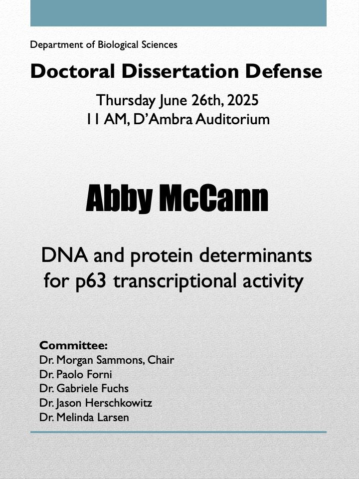

Congratulations are in order for [Abby McCann](/team/abby-mccann/) who successfully defended her dissertation on June 26th, 2025! 

Abby has been with us since 2021, having rotated with us during COVID. She developed three independent projects, two of which are now published in great journals. Her [first](/papers/mccann-nar/) examined the role of DNA syntax and grammar on p63-bound enhancer activity. Her [second](/papers/mccann-mcb/) manuscript was a tour-de-force, two author work on the role of the beta isoform of p63. One more manuscript is on its way, so look out!

Abby has now moved on to a research scientist position at Nemours Children's Hospital. 

We will miss Abby, her dedication, and her expert mentoring as she goes out into the world to bring all of her UAlbany-derived knowledge to bear on new biological questions. 

